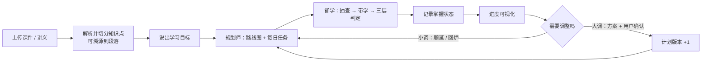
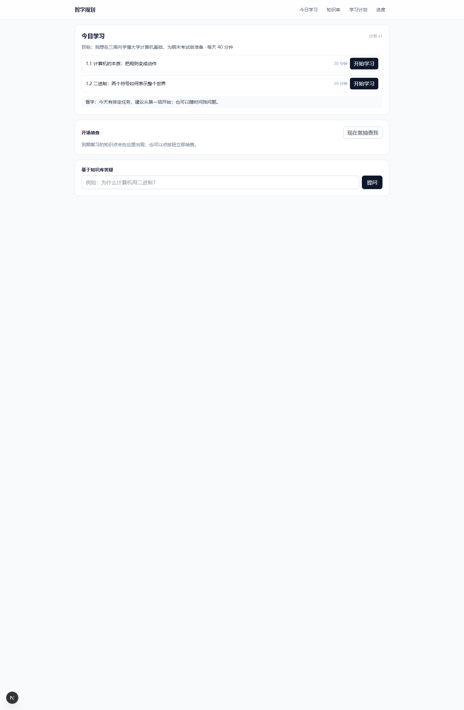
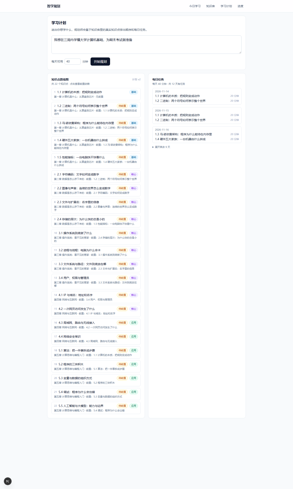
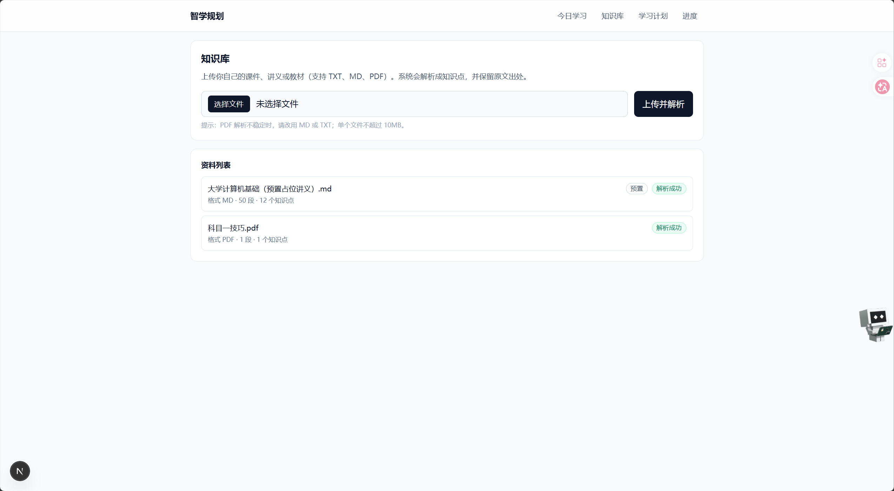
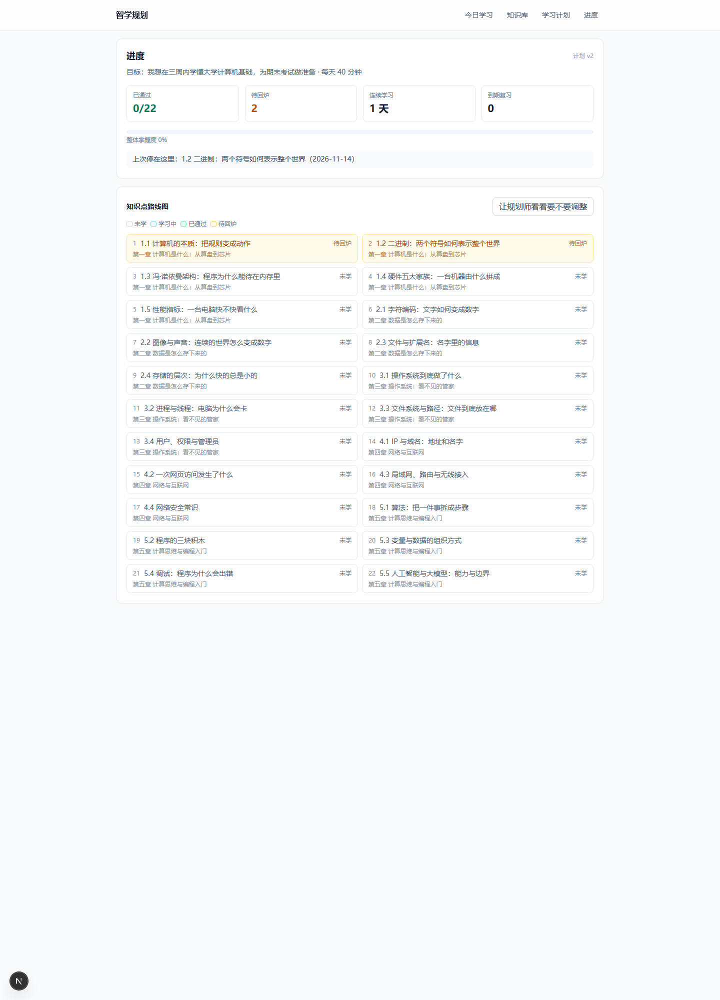

# 智学规划 Smart Learning Planner

一个由**双智能体协作**驱动的网页学习系统：你说清楚学习目标，规划师排出路线图与每日任务；督学带你学习，并用「讲清楚 → 做对题 → 做出来」三层判定你是不是真的学会了，判定结果反过来驱动计划自动调整。

华为云 CodeArts 比赛参赛作品。

## 核心特性

- **双智能体职责隔离**：规划师只管「学什么、什么顺序、每天多少」；督学只管「判定是否真的学会」。督学无法修改计划数据，测试直接验证。
- **三层判定**：每个知识点必须通过「讲清楚（复述+追问）→ 做对题（含变式题补考）→ 做出来（应用题评阅）」才算掌握，判定标准前置展示，每个知识点仅 1 次重判机会。
- **可溯源知识库**：上传 TXT / MD / PDF 讲义，自动切分知识点，每个回答标注来源（文档名 + 段落序号），资料外问题明确告知不编造。
- **计划自动调整**：小调（顺延、回炉）自动执行；大调展示前后对比，用户确认后计划版本递增（v1 → v2）。
- **进度可视化**：路线图四色着色、总进度、待回炉数、连续学习天数。

## 功能闭环



## 页面一览

| 今日学习 | 学习计划 |
|---|---|
|  |  |

| 知识库 | 进度 |
|---|---|
|  |  |

三层判定样例（讲清楚 / 做对题 / 做出来）与计划调整前后对比截图见 [docs/evidence/screenshots/](docs/evidence/screenshots/)。

## 快速开始

环境要求：Node.js ≥ 22（使用内置 `node:sqlite`，无需原生编译依赖）。

### 1. 配置模型服务

模型推理部署于华为云 ModelArts Studio 云端。复制环境变量模板并填写：

```bash
cp .env.example .env
```

```ini
MODEL_API_BASE_URL=<ModelArts Studio 接口地址，形如 https://xxx/openai/v1>
MODEL_API_KEY=<访问密钥，只放本机，不要提交>
MODEL_NAME_PLANNER=deepseek-v4.1-flash-1017
MODEL_NAME_COACH=deepseek-v4.1-flash-1017
```

### 2. 安装并启动

```bash
npm install
npm run dev
```

浏览器打开 http://localhost:3000 。首次打开知识库会自动载入预置的《大学计算机基础》讲义（22 个知识点），无需上传即可体验完整流程。

### 3.（可选）重置演示数据

```bash
node --experimental-strip-types scripts/reset-demo.mjs demo   # 演示模式：22 个知识点、2 个待回炉
node --experimental-strip-types scripts/reset-demo.mjs fresh  # 全新空库
```

## 主链路体验（约 20 秒）

上传（或用预置）讲义 → 在计划页写一句目标 → 规划师生成路线图与每日任务 → 在今日学习页学一个知识点（抽查 → 讲解 → 三层判定） → 在进度页看路线图着色 → 触发调整并确认，计划版本 v1 → v2。

## 技术栈

- **框架**：Next.js 15（App Router）+ React 19 + TypeScript + Tailwind CSS 4
- **持久化**：SQLite 单文件（Node 内置 `node:sqlite`，零原生依赖）
- **模型**：华为云 ModelArts Studio 部署的 deepseek-v4.1-flash-1017，接口地址与模型名全部走环境变量
- **测试**：Vitest（13 个测试文件、79 项用例全部通过）

## 目录结构

```
src/
  app/            # 页面与 API 路由（今日学习 / 知识库 / 计划 / 进度）
  lib/
    agents/
      planner/    # 规划师：独立提示词，只写 plan / daily_task / adjustment_proposal
      coach/      # 督学：独立提示词，只写 mastery_record / study_session
openspec/         # 规格驱动开发：主规格库 + 变更归档（可审计追溯链）
docs/
  user-guide.md          # 使用说明（非技术人员可照做）
  deployment-guide.md    # 部署说明（本地与云端 ECS 两种方式）
  demo-reset-guide.md    # 演示重置说明
  materials/             # 比赛材料：闭环图、全链路对应表、评分对应表、智能体分工图
  evidence/              # 开发过程证据：截图、判定样例、提示词、git log、问题记录
  backlog.md             # 范围冻结后记录的待办
```

## 文档索引

- 想用起来：[使用说明](docs/user-guide.md)
- 想部署：[部署说明](docs/deployment-guide.md)（本地运行 + 云端 ECS 步骤）
- 想复现演示：[演示重置说明](docs/demo-reset-guide.md) + [演示脚本](docs/demo-script.md)
- 想了解架构与分工：[双智能体分工图](docs/materials/04-agent-division.md)、[功能闭环图](docs/materials/01-loop.md)
- 想看开发过程：[开发证据目录](docs/evidence/README.md)（含六组任务的问题与修复记录）

## 开发过程说明

本项目采用 OpenSpec + Superpowers 规格驱动流程开发：提案（proposal → specs → tasks）经计划审查后实施，49 项任务全部完成并验证后归档，变更历史存于 [openspec/changes/archive/](openspec/changes/archive/)，主规格库存于 [openspec/specs/](openspec/specs/)。

比赛提交版本冻结于 tag `v1.0-competition`。
