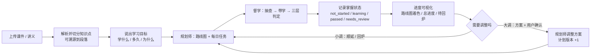

# 材料一：功能闭环图

## 闭环示意

## 七个环节与落地位置

| 环节 | 做什么 | 页面 | 接口 | 数据表 |
|------|--------|------|------|--------|
| 0 资料入库 | 上传 TXT/MD/PDF，解析切分，记录出处 | `/knowledge` | `POST /api/materials` | `source_material`、`knowledge_point` |
| 1 定目标 | 一句话目标 + 澄清追问 | `/plan` | `POST /api/goals` | `learning_goal` |
| 2 出计划 | 路线图（含前置依赖）+ 每日任务 | `/plan` | `POST /api/plans` | `plan`、`daily_task` |
| 3 每日学习 | 抽查 → 讲解 → 三层判定 | `/` | `/api/coach/start`、`/api/coach/judge` | `mastery_record`、`study_session` |
| 4 记结果 | 三层结果与整体状态 | `/`、`/progress` | `/api/plans/current`、`/api/progress` | `mastery_record` |
| 5 看进度 | 四色路线图、总进度、待回炉、连续天数 | `/progress` | `GET /api/progress` | 同上 |
| 6 调计划 | 小调自动；大调确认后版本递增 | `/progress` | `/api/plans/adjust`、`/api/plans/adjustment/confirm` | `adjustment_proposal`、`plan` |

## 一句话说明

闭环的支点不是"生成内容"，而是**判定**：只有三层判定产生的掌握状态，才能驱动路线图着色与计划调整，形成"学 → 判 → 看 → 调"的循环。

## 演示主线对应

上传 → 说目标 → 出计划 → 学一个点 → 看进度 → 调整确认，六个动作覆盖上表全部环节。系统实测耗时 18.5 秒。