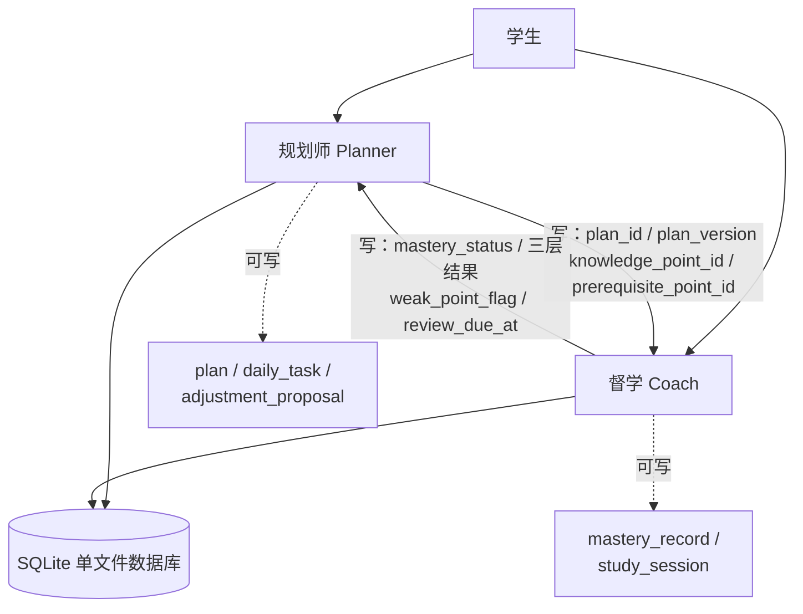

# 材料四：双智能体分工图

## 分工示意

## 职责对照

| 维度 | 规划师 Planner | 督学 Coach |
|------|----------------|------------|
| 一句话职责 | 管"学什么、什么顺序、每天多少" | 管"今天学完，并说实话会不会" |
| 触发时机 | 新建目标、用户要求重新规划、用户请求调整 | 进入今日学习页、完成一次作答、主动提问 |
| 输入 | 目标、每日时长、知识点清单与依赖、历史掌握度 | 今日任务、知识点原文、判定标准、历史结果 |
| 输出 | 路线图、每日任务、调整方案 | 抽查问题、讲解、三层判定、卡点记录 |
| 可写数据 | `plan`、`daily_task`、`adjustment_proposal` | `mastery_record`、`study_session` |
| 不可做 | 不判定是否掌握 | 不修改阶段级计划、不放宽标准 |
| 提示词位置 | `src/lib/agents/planner/system-prompt.ts` | `src/lib/agents/coach/system-prompt.ts` |
| 归档材料 | `docs/evidence/prompts/planner-v1.md` | `docs/evidence/prompts/coach-v1.md` |

## 交接字段

| 字段 | 含义 | 谁写 | 谁读 | 写入时机 |
|------|------|------|------|----------|
| `learning_goal_id` | 目标编号 | 系统 | 双方 | 创建目标时 |
| `plan_id` / `plan_version` | 计划与版本 | 规划师 | 督学 | 生成或调整计划后 |
| `knowledge_point_id` | 知识点 | 规划师 | 督学 | 生成计划时 |
| `prerequisite_point_id` | 前置知识点 | 规划师 | 督学 | 生成计划时 |
| `mastery_status` | 掌握状态 | 督学 | 规划师、进度页 | 每次判定后 |
| `explain_result` / `practice_result` / `apply_result` | 三层结果 | 督学 | 规划师 | 各层判定后 |
| `weak_point_flag` | 是否薄弱点 | 督学 | 规划师 | 每次判定后 |
| `review_due_at` | 下次复习日期 | 督学 | 规划师、抽查 | 三层全部通过后 |
| `mastery_layer_result` | 三层结果组合 | 督学 | 规划师 | 每次判定后 |

## 独立性如何保证

1. 两个模块使用不同提示词文件，互不引用。
2. 督学代码不导入任何计划写入函数；测试直接比对判定前后 `plan` 表内容完全一致。
3. 规划师代码不导入任何判定写入函数；判定只能通过督学接口发生。
4. 两者共用模型客户端与检索器，但模型名、可写表范围分开配置。

## 演示时的指认点

1. 学习页出现"督学讲解 / 督学判定 / 判定标准"——这是督学在执行。
2. 计划页出现"开始规划 / 路线图 / 每日任务"——这是规划师在执行。
3. 进度页出现"规划师的调整方案"——这是督学上报后由规划师给出的方案。
4. 计划版本从 v1 变为 v2——这是两个智能体交接后产生的可观察结果。